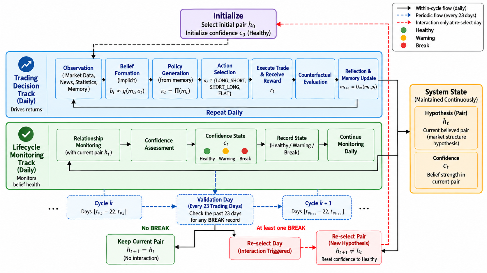
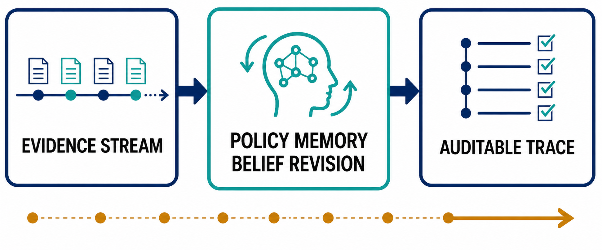
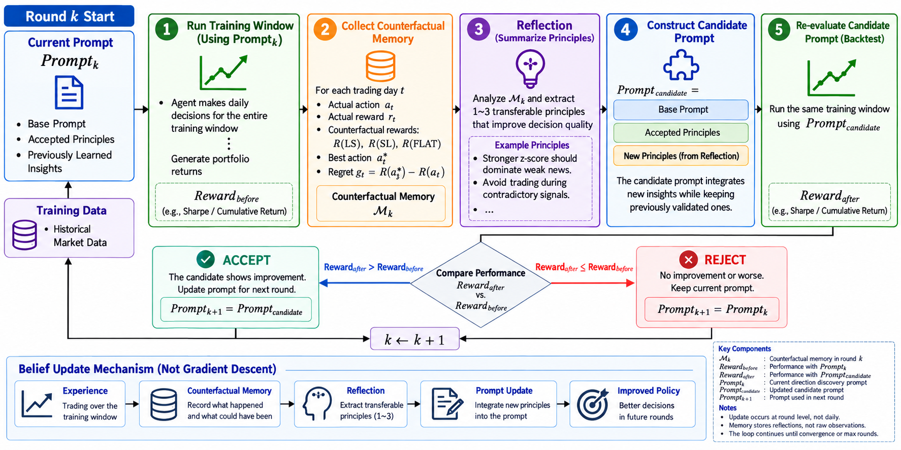
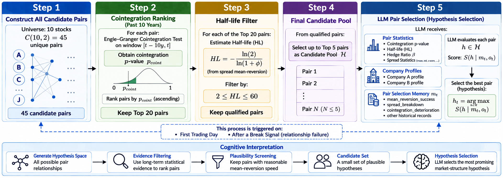
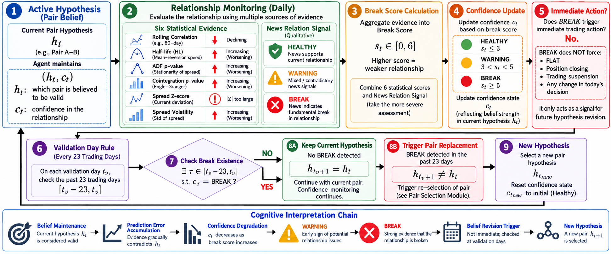
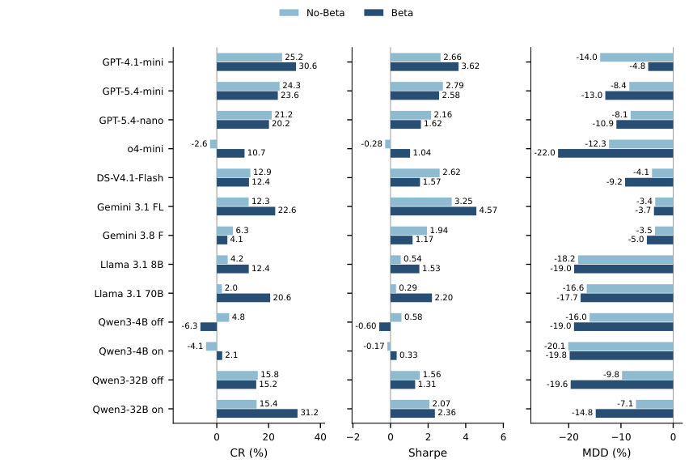

# MOIRA

MOIRA combines statistical pair screening, language-model decisions, compact policy memory, and lifecycle monitoring in a sequential pair-trading environment. Open-weight and hosted models use the same simulation engine.

## Framework

1. **Pair selection:** screen prices from the ten calendar years strictly before each selection date, then select a candidate using statistics, news and company context.
2. **Policy learning:** propose transferable guidance from training reflection; retain an edit only when replay improves reward. Freeze the learned global prompt during testing.
3. **Daily decisions:** select Long–Short, Short–Long or Flat, with feedback from settled counterfactual outcomes.
4. **Pair maintenance:** evaluate accumulated break evidence at 23-session validation boundaries. A daily break alone does not replace a pair.

The main experiment has 27 training sessions and 75 test decisions. The following price-only session settles the final decision without an additional news observation or model call. No-Beta and Beta change exposure; policy training uses No-Beta. A1/A2 retain their pre-specified 28-session training windows. A3 disables post-warmup policy consolidation; A4 disables pair replacement while retaining daily decisions and monitoring.

**Figure 2. Overall workflow**

Task and module diagrams (Figures 1, 8–10)

**Figure 1. Conceptual task**

**Figure 8. Policy-memory learning and validation**

**Figure 9. Pair selection**

**Figure 10. Lifecycle monitoring**

## Results reported in the paper

CR and MDD are percentages; Sharpe is unitless. These are the paper’s selected results, not averages over seeds. All reported results and figures follow the Overleaf manuscript.

| Model / baseline | No-Beta CR | Sharpe | MDD | Beta CR | Sharpe | MDD |
|---|---:|---:|---:|---:|---:|---:|
| GPT-4.1-mini | 25.2 | 2.66 | -14.0 | 30.6 | 3.62 | -4.8 |
| GPT-5.4-mini | 24.3 | 2.79 | -8.4 | 23.6 | 2.58 | -13.0 |
| GPT-5.4-nano | 21.2 | 2.16 | -8.1 | 20.2 | 1.62 | -10.9 |
| DeepSeek-V4.1-Flash | 12.9 | 2.62 | -4.1 | 12.4 | 1.57 | -9.2 |
| o4-mini | -2.6 | -0.28 | -12.3 | 10.7 | 1.04 | -22.0 |
| Gemini 3.1 Flash-Lite | 12.3 | 3.25 | -3.4 | 22.6 | 4.57 | -3.7 |
| Gemini 3.8 Flash | 6.3 | 1.94 | -3.5 | 4.1 | 1.17 | -5.0 |
| Llama-3.1-8B-Instruct | 4.2 | 0.54 | -18.2 | 12.4 | 1.53 | -19.0 |
| Llama-3.1-70B-Instruct | 2.0 | 0.29 | -16.6 | 20.6 | 2.20 | -17.7 |
| Qwen3-4B (thinking off) | 4.8 | 0.58 | -16.0 | -6.3 | -0.60 | -19.0 |
| Qwen3-4B (thinking on) | -4.1 | -0.17 | -20.1 | 2.1 | 0.33 | -19.8 |
| Qwen3-32B (thinking off) | 15.8 | 1.56 | -9.8 | 15.2 | 1.31 | -19.6 |
| Qwen3-32B (thinking on) | 15.4 | 2.07 | -7.1 | 31.2 | 2.36 | -14.8 |
| Passive LS | 2.6 | 0.37 | -25.1 | 2.4 | 0.36 | -24.9 |
| Passive SL | -8.1 | -0.47 | -30.3 | -7.9 | -0.46 | -30.0 |
| Passive EW | -10.4 | -0.86 | -22.3 | -10.4 | -0.86 | -22.3 |
| EG+Z | -9.92 | -0.84 | -15.17 | -10.17 | -0.87 | -15.26 |
| EG-DDQN | 11.25 | 0.98 | -22.42 | 15.10 | 1.27 | -17.21 |
| FinMem (GPT-4.1-mini) | 13.53 | 3.07 | -2.54 | 15.64 | 2.91 | -3.71 |

**Figure 26. All 13 model configurations under both exposure rules**

[PDF](paper/figures/figure_26_metrics_all.pdf)

| Study | Model / exposure | Condition | CR | Sharpe | MDD |
|---|---|---|---:|---:|---:|
| A1 | GPT-4.1-mini / Beta | Full | 16.19 | 0.61 | -11.1 |
| A1 | GPT-5.4-mini / No-Beta | Full | 25.41 | 0.83 | -17.4 |
| A2 | GPT-4.1-mini / Beta | Full | 8.39 | 1.93 | -3.9 |
| A2 | GPT-5.4-mini / No-Beta | Full | 6.18 | 1.27 | -4.4 |
| A3 | GPT-4.1-mini / Beta | With update | 30.6 | 3.62 | -4.8 |
| A3 | GPT-4.1-mini / Beta | Without update | 23.4 | 2.51 | -10.4 |
| A3 | GPT-5.4-mini / No-Beta | With update | 24.2 | 2.79 | -8.4 |
| A3 | GPT-5.4-mini / No-Beta | Without update | 2.7 | 0.41 | -19.2 |
| A4 | GPT-4.1-mini / Beta | With reselection | 30.6 | 3.62 | -4.8 |
| A4 | GPT-4.1-mini / Beta | Without reselection | 2.8 | 0.38 | -21.8 |
| A4 | GPT-5.4-mini / No-Beta | With reselection | 24.2 | 2.79 | -8.4 |
| A4 | GPT-5.4-mini / No-Beta | Without reselection | 15.4 | 2.02 | -7.3 |
